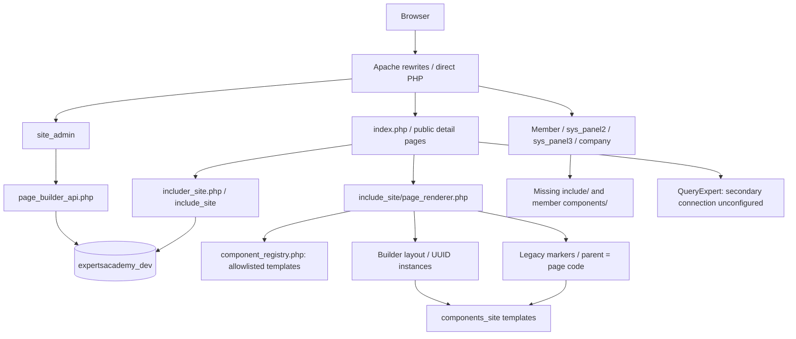

# Application architecture

**Phase 2 addition:** [Design Studio architecture](PHASE2_DESIGN_STUDIO.md) documents the reviewed registry, typed token compiler, shared PHP rendering, React CMS screens, forms and versioning. This retained architecture text describes legacy and Phase 1 areas unless stated otherwise.

**Phase 1 update:** [Independent Page Studio architecture](PHASE1_CMS_FOUNDATION_2026-11-01.md) is implemented under `include_site/studio/` and `site_admin/studio/`, with Composer/npm build pipelines, eight new tables and shared PHP preview/public SSR. `index.php` now checks an explicit Studio publication before the retained renderer described below. No existing page has been switched. The remainder of this document describes the retained/pre-Phase-1 architecture.

**Reviewed 2026-11-01** against the active workspace. Current local HTTP checks cover public CMS pages and selected unauthenticated gates. Legacy applications and remote services remain source-reviewed rather than fully exercised.

## Application areas

The repository contains a procedural PHP public website, a CMS, an older member portal, two operations dashboards, and a company dashboard. Apache rewrites coexist with directly addressable PHP scripts. Front-end packages are copied into asset/vendor directories; there is no central framework, Composer dependency manifest, or npm build pipeline. There are now dedicated Builder migration and test scripts, so the earlier statement that the project had no migration/test code is obsolete.

## Public request and page composition

`includer_site.php` loads the main configuration, helpers, settings, Jalali date functions, request parameters, and the selected `fa`/`en` language file. Language is allowlisted with Persian fallback. `index.php` selects a `tbl_categories` row with `type=4`, locale, and either URL slug or home flag; missing pages return 404. Header/footer render common navigation, settings, and assets.

`include_site/page_renderer.php` checks `tbl_page_builder_layouts` for the exact page code and locale. `mode=builder` selects UUID instances; an absent layout, Legacy mode, or failed Builder instance query uses the original design-marker path. A valid empty Builder instance list deliberately renders an empty page body. A missing translation is skipped without substituting another locale.

Legacy pages retain their newline-separated `tbl_categories_design` markers and page-code parents in `tbl_textsection` / `tbl_content`. Builder pages select enabled, non-deleted instances in `sort_order,id` order and read content using `parent=instance UUID`. Both paths use code-owned Registry template paths. Neither a request nor a stored marker can supply an arbitrary PHP path.

The Registry has **36 definitions**, including **4 hidden companion-heading definitions**, leaving **32 catalog choices**. The `title` type keeps four legacy marker variants through one template; this does not assert four distinct new visual designs. `multiple` in a definition means a list of content rows, not a limit on how many component instances can be added. [The exported registry](COMPONENT_REGISTRY.tsv) enumerates fields, storage, variants, and templates.

Custom lists combine `tbl_content` rows with a heading in `tbl_textsection`, both attached to the instance UUID. FAQ accordion types and the collaboration form are separate definitions. Only the explicit `faq_form` component renders that form.

### Ordering compatibility

Legacy content queries intentionally keep their historical `ORDER BY tbl_content_order ASC` behavior. The converter reads that observed sequence and inserts clones in sequence; Builder content reads add an explicit ID tie-breaker. The `custom_two` and `custom_four` templates have their own descending-ID queries and receive a special source-ID-preserving clone order. Do not add a global ID tie-breaker to Legacy rendering: the October comparison showed that doing so changed the visible order on existing pages.

The guarded `repair_clone_order.php` utility repairs untouched, independent revision-1 conversions only after checking that clone payloads equal Legacy payloads. It is not a general content recovery tool. The conversion fix and the correction of 13 new clone rows on `BEC40D0/fa` are recorded in the Builder report.

## Builder CMS and persistence

`site_admin/page_builder.php?code=...` offers locale switching, a searchable catalog, an ordered instance list, and a TinyMCE inspector. Add, duplicate, delete, toggle, and move are server actions; move uses up/down controls. Content is saved per selected instance. Structural mutations take effect immediately after a successful request. There is no draft/publish layer, content revision history, undo stack, or embedded live page canvas; public preview links open the rendered page separately.

`site_admin/category_manage.php` remains responsible for page title, URL, SEO, and access to the Legacy design editor. The Builder does not synchronize later Legacy content edits into already copied UUID content. Existing sidebar/editor/list enhancements and the general contact inbox are separate CMS features.

`page_builder_api.php` uses its own `utf8mb4` mysqli connection, prepared SQL, CSRF tokens, transactions, per-locale revisions, instance/page/locale checks, field allowlists, and rich-text sanitization. The CMS login session grants Builder access; no separate per-user page ACL is implemented. The [API reference](PAGE_BUILDER_API.md) describes its precise contract and limits.

Two additive InnoDB tables hold layouts and instances. Actual content remains in the existing tables under UUID parents; instance deletion is soft. Removed content-list items are detached using a `removed:` parent prefix. Revision numbers detect concurrent writes; they are not stored historical versions.

### Locale structure

The same category code establishes the page pair; titles and slugs are not used to guess translations. Layouts start independent. Explicit `share_structure` requires both active locales, matching revisions, and exact ordered type/marker/enabled sequences. It copies English content to the Persian UUIDs, soft-deletes prior English instances, and marks the Persian instances shared. Locale text remains separate. Structural changes then bump both locale revisions, while content saves affect one locale. No UI action splits a shared structure back into independent instances. The 2026-11-01 development snapshot has 28 independent layouts and no shared layout.

## Other applications and integrations

`site_admin/` uses present `include_site/` helpers and `siteadmin_login`. Page gates and the separate CMS AJAX/Builder API gates are implemented independently. `form_contact.php` provides read/search/pagination and a CSRF-protected reviewed-status update for general contact submissions.

`sys_panel2/` has 107 top-level PHP files and role-oriented Falcon navigation. `sys_panel3/` has 63 top-level PHP files with a separate older interface. `company/` has nine top-level PHP files. Their bootstraps require the absent root `include/` tree. Contract imports also require absent `include/SimpleXLSX.php`. Root `panel.php` requires the missing `components/$do.php` views. Filenames shared between panels do not establish identical behavior.

Public category, class, course, library, and registration flows can call `QueryExpert()`, whose four secondary connection globals have no assignments in this source. The normal `Query()` helper still opens a connection per call and uses `utf8`; Builder writes using `utf8mb4` do not establish full Unicode support in every Legacy read/storage path.

Other source integrations are SQL Server contract import (`sqlsrv`), SMS, PHP mail, external login/LMS links, chat completion proxy, and CDN/widget assets. Database cloning does not isolate those external effects. No valid form, message, payment, SMS, email, chat, SQL Server, or production request was sent in the current review.

## Boundaries

The current database contains 27 tables while static PHP SQL names 72 tables; the remaining 45 names are not defined in the historical dump or current local schema. Current public CMS success does not establish that the other applications can run. Remaining security risks, schema drift, backups, and optional cleanup constraints are documented separately. This review updated documentation and read-only evidence; it did not complete the pending migration or change application behavior.
