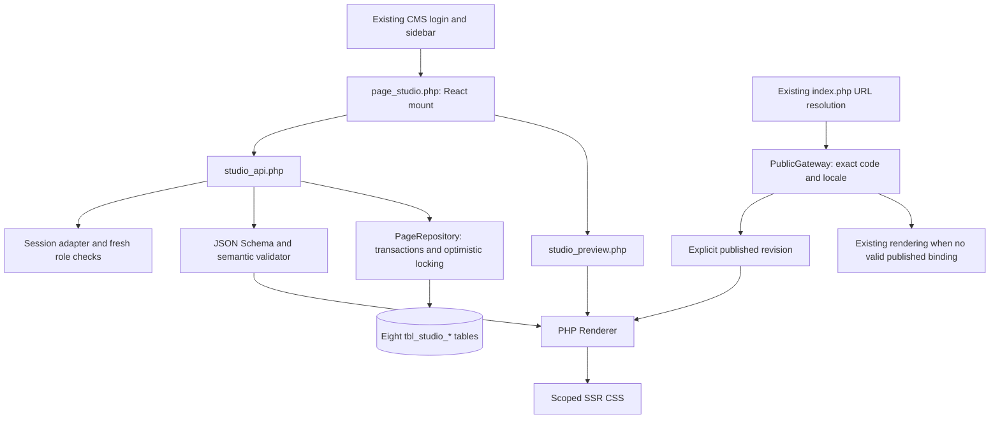

# Phase 1 — integrated CMS Page Studio foundation

Implemented and verified on **2026-11-01** in `/opt/lampp/htdocs/expertsacademy`. This report supersedes the pre-Phase-1 environment/count statements in the earlier project review. Existing Builder documentation remains a reference for the retained implementation.

## Delivered state

- CMS entry: `site_admin/page_studio.php`, available through the existing CMS sidebar and login.
- Independent backend: `include_site/studio/`; independent editor source: `site_admin/studio/`.
- Eight additive tables, versioned JSON contracts, schema validation, immutable revisions, draft/publication separation, role adapters, CSRF-protected APIs and PHP SSR.
- React editor mounted inside the current CMS shell: create/open, property editing, tokens, section dragging with pointer/keyboard, validation, revision history, save, PHP preview and explicit publication confirmation.
- Three independently implemented components: `hero`, `text`, `feature-grid`, all version 1. No old Builder or `components_site` implementation is imported by Studio.
- Development contains one **unbound, unpublished** sample, ID `0f2c0267-1919-4e6d-976c-fc9b971e7efa`. No existing public page has been switched to Studio.

See [developer setup and API](PHASE1_DEVELOPER_SETUP.md), [backup/rollback](PHASE1_BACKUP_ROLLBACK.md), [test evidence](PHASE1_TEST_RESULTS.json), and the [file changes manifest](PHASE1_FILES.tsv).

## Audit and actual environment

The existing public site uses procedural PHP, `includer_site.php`, Apache rewrites, `tbl_categories` and shared header/footer files. Before Phase 1 there were 27 tables: 25 historical tables and two old Builder tables. The 52 CMS page/locale rows, 28 old Builder layouts and all associated content are retained. Details of missing member/operations dependencies, external integrations and legacy security issues remain in [the project review](PROJECT_REVIEW_2026-11-01.md) and [security observations](SECURITY_OBSERVATIONS.md).

| Area | Verified version / finding |
| --- | --- |
| Apache / PHP | XAMPP Apache 2.4.58; PHP 8.2.12, with PDO MySQL, mysqli, JSON and PHPUnit-required extensions available. |
| Configured database | `expertsacademy_dev`, **MariaDB 10.4.32**, not MySQL 8. |
| MySQL 8 compatibility | MySQL **8.4.11**, a private socket-only temporary instance; full migration/integration suite passed. No service replacement or database conversion was performed. |
| Node / npm / Composer | 24.22.1 / 11.19.1 / 2.11.1. Composer was installed privately after verifying the official installer signature. |
| Backend dependencies | Opis JSON Schema 2.6.0; PHPUnit 11.5.57, selected for PHP 8.2 compatibility. Locked in `composer.lock`. |
| Editor | React 19.3.1; TypeScript 7.0.2; Vite 8.3.5; Zustand 5.0.16. |
| Interaction / styling | dnd-kit core 6.3.1, sortable 10.0.0; Radix Dialog 1.3.1; Tailwind 4.3.3. |
| Browser/unit tests | Vitest 5.0.5; Playwright 1.64.1; installed Chrome 155.0.8059.79. Browser download returned HTTP 403; the installed local browser was used. |
| Git | Zero tracked project files at audit time. Backup manifests, rather than `git diff`, establish the change inventory. |

The XAMPP system tables `mysql.proc` and `mysql.event` have an older column layout. Routine/event metadata queries fail; direct checks confirmed **zero routines, events and triggers** in the development database, so the verified dump contains all actual database objects. No system-table upgrade was attempted. The real application database remains on MariaDB; MySQL 8 testing establishes compatibility of the new foundation, not compatibility of every legacy application.

Legacy assets are copied vendor bundles. Existing media uses historical filesystem paths, a TinyMCE file manager and content-table filename fields; no common media identity or ownership model exists. Studio introduces metadata storage and read APIs only. It does not delegate uploads to the legacy file manager. The new components accept text and safe links, with no executable markup or media-upload surface in Phase 1.

## Architecture and request flow

`index.php` still resolves the original category row, locale, slug/home behavior and missing-page 404. Studio looks up only the exact existing category code plus locale. A valid explicitly published revision selects the new renderer. Absent schema, missing publication or an invalid stored revision returns to existing rendering; exceptional failures are logged without credentials or SQL text. The old renderer is not loaded for Studio output.

The same `Renderer::fragment()` generates the component markup for public pages and `Renderer::document()` preview. React contains no competing component renderer. Preview wraps that fragment in a sandboxed iframe and a restrictive CSP. Existing header, navigation, footer, URL rewrites and default SEO remain in use. Only a published Studio page supplies its escaped title, description and keywords; drafts never change public SEO.

## Contracts, registry and rendering

`contracts/*.v1.json` use JSON Schema draft 2020-12. Schema IDs are registered from local files; their HTTPS identifiers do not trigger remote schema requests. Contracts define pages, sections, component envelopes, tokens, templates and the three component property objects.

The page document contains `schemaVersion`, lowercase UUID v4 `id`, `title`, `locale`, `seo`, typed `design` tokens and ordered `sections`. Each section has its own version/UUID, layout and ordered components. A component has UUID, allowlisted `type`, integer `version`, and schema-validated `props`. A [valid example](../include_site/studio/examples/page.v1.json) is provided.

Limits: 1 MiB request/document, JSON depth 64, 100 sections, 50 components per section and 1,000 components total. Unknown fields, duplicate IDs, noncanonical UUIDs, unsupported versions, unknown component types and invalid tokens are rejected. URLs must be a single-root relative URL or HTTP(S) URL with a host; protocol-relative URLs, credentials, controls and executable schemes are rejected.

`Registry` owns the allowlist and schema mapping. Database metadata records supported definitions and checksums; database rows cannot supply PHP paths or executable rendering code. Version 1 is supported explicitly. Future versions require new contracts, renderer support and a new migration; there is no silent downgrade or generic document-upgrade implementation.

Rendering escapes text/attributes with `ENT_QUOTES | ENT_SUBSTITUTE`, then applies `nl2br` only to escaped body text. User HTML, PHP, JavaScript, CSS and event handlers are unsupported. CSS variables come exclusively from typed colors, bounded numbers and font enums. Preview permits these engine-generated style attributes while blocking scripts. Styles are scoped to `.ea-studio`; editor styles use a Tailwind prefix without global preflight. Long words wrap on narrow previews.

## Persistence and migrations

Schema source: [`001_foundation.up.sql`](../include_site/studio/database/001_foundation.up.sql), [`001_foundation.down.sql`](../include_site/studio/database/001_foundation.down.sql).

| Table | Responsibility |
| --- | --- |
| `tbl_studio_migrations` | Applied version, checksum, timestamp. |
| `tbl_studio_pages` | Identity, locale, optional existing category binding, optimistic lock and draft/published pointers. |
| `tbl_studio_revisions` | Immutable versioned document, canonical SHA-256 checksum and revision ordinal. |
| `tbl_studio_component_versions` | Component type/version schema metadata and checksum. |
| `tbl_studio_events` | Create/save/publish audit events, actor and previous publication/version references. |
| `tbl_studio_design_tokens` | Versioned token sets. |
| `tbl_studio_templates` | Versioned starter documents. |
| `tbl_studio_media` | Future media identity, storage key, MIME, dimensions, byte count and alt text. |

All new tables are InnoDB/utf8mb4. Revision/event foreign keys restrict page deletion; draft/publication ownership is also checked in repository joins. JSON is native on MySQL 8 and a compatible JSON alias on MariaDB. Application validation applies on both engines.

Create and save write page state, revision and event in a transaction. Saves/publication lock the page row and require `expectedVersion`; stale requests return 409. Publication moves a separate pointer and increments the lock; editing a published page creates a draft revision without changing public output. Page ID, locale and binding are immutable through edit APIs. Bindings must identify exactly one existing category/locale, and a unique database key prevents duplicate bound Studio pages.

Migration 001 creates only new tables and seeds three definitions, one token set and one template. It uses an advisory lock, checksum ledger and idempotent DDL. MySQL DDL implicitly commits: this is **not** a transactionally atomic schema upgrade. Interrupted DDL can be rerun because ledger/seed data commit last. Never edit an applied migration or its seeded contract/source definitions; add a subsequent migration instead. The present runner implements migration 001 and must be extended for the next version.

The development database now has **35 tables**. The 27 preexisting tables have identical row counts and per-table row-content hashes to the verified pre-change backup. [Preservation evidence](PHASE1_PRESERVATION.json) and [HTTP comparison](PHASE1_COMPARISON.json) contain aggregate/hash results without record content.

## Authentication and boundaries

`Auth` uses the existing numeric `siteadmin_login` session identity. Every request rereads `tbl_user`, checks `active=1`, and maps the CMS role labels found in `site_admin/user.php`:

| Existing status | Studio permissions |
| --- | --- |
| `0` — administrator | Read, edit, publish. |
| `1` — secretariat | Read/preview/validate only. |
| `2` — public relations | Read and edit; no publication. |
| Unknown/inactive/missing | Denied. |

There is no separate login system and no new password database. The inherited MD5 login scheme remains a legacy risk, not a new authentication guarantee. Studio rotates the session on its first use by an actor, uses HttpOnly/SameSite cookies and HTTPS-secure cookies when HTTPS is present, and has a separate random CSRF token. API methods and fields are allowlisted, SQL uses native prepared statements, and errors omit SQL/credentials. Account deactivation and role changes take effect on the next request. Per-page ACLs and SSO are outside this phase.

Backend/source directories deny HTTP access via their own `.htaccess`. Apache testing found preexisting `.git/config` and `site.sql` exposures; narrow root rules now deny hidden metadata (except `.well-known`) and SQL exports. Normal public routes were rechecked after that change. All new backups, restored copies, session fixtures and test-server artifacts live outside the web root.

Writes are allowed only to `expertsacademy_dev`, guarded test schemas, or a separately named database explicitly enabled with `EA_STUDIO_WRITE_DATABASE`. The protected original `expertsacademy` is always denied. The migration runner is stricter: development/test targets only. Test overrides work only under CLI/CLI-server with an approved schema prefix and `/tmp/` socket.

## Verification and limitations

- PHPUnit: **20 tests / 86 assertions on MySQL 8.4**, and **20 / 86 on isolated MariaDB**. Includes migration down/up/idempotence, unchanged legacy tables, validation, escaping, immutable revisions, stale saves, role revocation, binding and preview/render parity.
- Vitest: **6 tests** covering detached state, immutable updates, ordering and defaults.
- Playwright: **3 tests**, covering authentication/CSRF/roles, real editor creation/edit/save/keyboard movement, PHP preview, design tokens, escaping, mobile overflow and published-route parity. Publication occurred only in an isolated database. The three browser workflows passed three consecutive repetitions (nine executions).
- PHP lint: **27 changed/new application and test PHP files** passed. TypeScript and Vite production build passed. npm and Composer audits reported no known advisories for installed/locked new dependencies.
- All **48 preexisting route checks** retain expected status, visible-text hash, section/form counts and no PHP error markers. Eleven blank-slug English rows are skipped exactly as before. Ten Apache boundary checks pass.

These checks establish the foundation and preservation of measured CMS behavior. They do not establish complete business-flow coverage of the legacy member/operations/company applications. External email, SMS, payments, LMS, SQL Server and chat integrations were not exercised. No bulk legacy conversion, page deletion API, media uploader, automatic revision restore UI or full visual component-design system is claimed. The property inspector intentionally edits structured JSON in this foundation phase.

## Files created or modified

New files are grouped under `include_site/studio/`, `site_admin/studio/`, compiled `site_admin/asset/page-studio/`, `site_admin/page_studio.php`, `site_admin/studio_api.php`, `site_admin/studio_preview.php`, `asset_site/css/page-studio.css`, and Phase 1 documentation/evidence. Lockfiles capture installed dependencies; `vendor/` and `node_modules/` are generated dependencies, excluded from the source manifest.

Existing application changes are limited to **four files**: `index.php` (published gateway), `header_site.inc.php` (conditional SSR stylesheet), `site_admin/header.inc.php` (sidebar link), `.htaccess` (metadata/SQL protection). Documentation entry points point to the new report while retaining historical review evidence. The exhaustive [manifest](PHASE1_FILES.tsv) includes new source/build files and changed existing files, byte sizes and SHA-256 hashes; no content rows or secrets are embedded.
