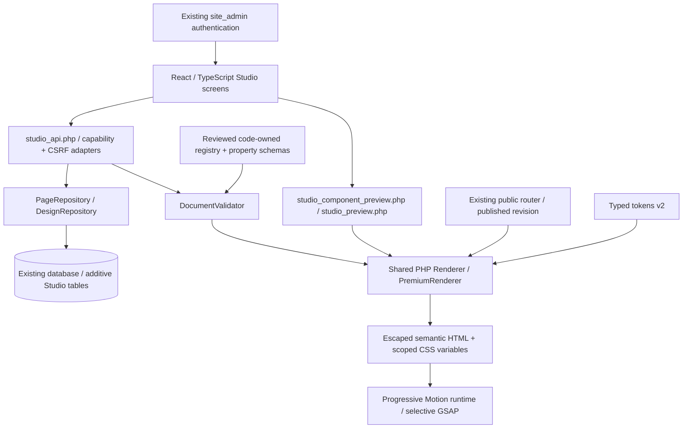

# Phase 2 — Design System and Component Studio

Implementation date: 2026-11-01. Verification evidence is in `PHASE2_TEST_RESULTS.json`; deployment state and the sample page ID are in `PHASE2_DEPLOYMENT.json`. These files are generated after the final checks. Phase 1 remains the foundation; the legacy Builder is retained independently.

## Integrated CMS screens

| Screen | Entry point | Purpose |
| --- | --- | --- |
| Page Studio | `site_admin/page_studio.php` | Create/edit versioned pages, insert components, apply a theme snapshot, review upgrades, preview/save/publish. |
| Component Studio | `site_admin/component_studio.php` | Search 20 categories, inspect schemas, edit properties/presets, compare variants and component versions, preview responsive/RTL/dark output, submit registration briefs, manage lifecycle metadata and inspect quality results. |
| Design System | `site_admin/design_system.php` | Edit typed tokens, check semantic contrast, preview PHP output, duplicate/export themes and save immutable theme versions. |
| Studio Requests | `site_admin/studio_leads.php` | Publisher-only inbox for the new library’s forms. No external messages are sent. |

All screens reuse the existing CMS login, session and panel shell. API writes retain capability checks, CSRF, strict request envelopes, prepared statements and optimistic version checks. Public pages keep their existing URLs and rendering mode until an explicit Studio binding/publication. No legacy component implementation is imported into the new renderer.

## Architecture

### Responsibilities

- `include_site/studio/catalog/components.v1.json`: reviewed composition briefs, categories, fields and documentation. `ComponentCatalog.php` builds strict property schemas, defaults and presets. `Registry.php` resolves exact type/version pairs; database proposal records cannot introduce executable implementations.
- `contracts/page.v2.json` and `contracts/tokens.v2.json`: strict, versioned JSON contracts. Page v1 and the three Phase 1 types continue to validate and render. Section/component envelope versions stay explicit; a page revision records its actual page schema version.
- `PremiumRenderer.php`: 60 explicit semantic component implementations. Escaping is contextual; links are validated recursively; curated media keys resolve to reviewed local assets. No user PHP, JavaScript, executable template, HTML fragment or arbitrary CSS is accepted as component content.
- `Renderer.php`: validates the whole document, scopes tokens/responsive rules to its page UUID, renders either page version, emits CSP-compatible styles and loads the same optional runtime for preview and publication. The standalone preview’s hidden context heading is outside `<main>` and does not change publication parity.
- `DesignRepository.php`: immutable theme versions, registration proposals, lifecycle metadata. Deprecation does not invalidate or rewrite existing documents.
- `ComponentMigrations.php`: reviewed transformations. A dry run returns a replacement and review notes; the editor applies it locally and the user explicitly saves a new revision. Nothing upgrades published content automatically.
- `PublicLead.php` / `studio_lead.php`: bounded public form contract, separate public CSRF namespace, consent, honeypot and session rate limit. Leads stay in the new table; no email/SMS integration is implied.
- `QualityReport.php`: evidence tied to a source fingerprint; changes to rendering, tokens, schemas, media metadata, responsive rules or runtime mark results stale.

## Component scope and visual identity

The quota is **60 new types, 240 composition variants**, three types per category and four variants per type. Hero editorial additionally has a reviewed v2 implementation with four render cases. It is not counted as another type or as quota variants. Including retained Phase 1 types, the registry contains 63 unique types / 64 versioned definitions. The generated `PHASE2_COMPONENTS.md` and `PHASE2_COMPONENT_REGISTRY.json` list every type, property schema, variant, preset and version.

The identity combines forest green, warm ivory and restrained amber, Manrope UI typography, Fraunces editorial display and the existing Persian academy font. Fonts are local; the new Latin font licenses are bundled. Logical CSS properties and explicit `dir` support Persian/English. Variants change hierarchy, placement, composition, grouping or interaction. Automated checks verify four distinct layout signatures per type/version in addition to explicit per-type body structures; contact sheets and screenshot baselines provide visual review evidence.

All components have configurable content, validated defaults, Academy/concise presets, typed motion settings, responsive rules, semantic markup, keyboard focus and tests. Interactive types use native controls or progressive enhancements: disclosures, keyboard tabs, manual carousels, estimators, image comparison and accessible forms. Image helpers emit optimized local WebP sources, dimensions, lazy loading and responsive source sets. The gallery uses generated WebP previews for all 240 core variants.

### Design tokens

Tokens are nested structured JSON compiled into CSS variables, not free-form styles. They include:

- Light/dark semantic palettes, brand/on-brand, surfaces, text, muted, borders, accent, feedback and focus.
- Latin/RTL font choices, base/display/heading scale, ratio and line height.
- Spacing unit, section/card padding, gaps, container/reading widths, grid columns and configurable mobile/tablet/desktop thresholds.
- Radii, shadows, button shape/weight/height, background pattern, gradient angle and overlay opacity.
- Global motion enabled/preset/duration/distance/easing, with per-component overrides.

Semantic text pairs must meet 4.5:1 in both palettes, and breakpoints must increase. CSS consumes the typed breakpoints when compiling scoped media rules, rather than silently using fixed thresholds. A saved theme version is immutable. New v2 pages and Component Studio use the latest Academy default; existing page documents keep their own snapshots. Applying a different theme is an explicit editor action.

### Motion and progressive enhancement

Motion handles entrance/stagger effects; GSAP is dynamically imported only for the advanced storytelling emphasis preset. There is no autoplay carousel or video. Content is visible before JavaScript, all tab panels are readable without enhancement, and forms have a non-JavaScript fallback. Reduced-motion changes cancel ongoing enhancement. The runtime entry is approximately 27 KB gzip; the selective GSAP chunk is approximately 27 KB gzip, according to the verified Vite build.

## Database and compatibility

Migration `002_design_studio` adds three InnoDB/utf8mb4 tables: component proposals, lifecycle metadata and leads. It appends 61 reviewed component versions, default theme v2 and demonstration template v2 to Phase 1 tables. It does not alter legacy tables or existing page revisions. The separately created demonstration page is unbound and unpublished.

Phase 1 migration seed data and its installed checksum are frozen in `database/001_seed.json`. New registry entries cannot silently change an installed migration’s meaning. Migration 002 has its own checksum and advisory lock; a repeat call is idempotent. Later changes to seeded schemas/defaults require a new migration. MySQL DDL auto-commits, so backup restoration is the deployment rollback mechanism; only disposable test schemas expose automated down methods.

Development is **MariaDB 10.4.32**, not MySQL 8. The same integration suite also runs on an isolated MySQL 8.4.11 instance. PHP 8.2.12, Node 24.22.1 and the exact lockfiles are used. JSON encoding temporarily sets `serialize_precision=-1` and restores the prior setting; this prevents native MySQL JSON float normalization from breaking revision checksums under XAMPP’s precision=100. The old MariaDB system metadata mismatch remains a separate DBA issue; no system-table upgrade was performed.

## Demonstration and editorial content

Authenticated `studio_component_preview.php?demo=curated&locale=en&mode=light` renders a complete 15-section demonstration; `demo=all` renders all 60 types. Add `locale=fa`, `mode=dark` to inspect other settings. `bin/studio.php design-sample` creates an unbound unpublished copy for editing. It never switches an existing public route.

Statistics, quotes, people roles, partner names, prices and course details in defaults are illustrative editorial content. Replace and approve them before public publication. Image source references are recorded in `catalog/media.v1.json`; no remote embed or tracking dependency is required.

## Verification and boundaries

See `PHASE2_TEST_RESULTS.json`, PHPUnit/Playwright XML reports, the full component matrix and private visual baselines for measured results. The matrix includes all core variants plus reviewed v2, six viewport/language/theme scenarios, two automated accessibility audits per versioned variant, keyboard focus, overflow, media decoding and reduced-motion checks. Screenshot comparison is a second pass against captured baselines, not merely screenshot generation.

These checks establish the tested defaults and interactions in installed Chrome; they do not constitute a full WCAG certification or cover every possible editor-authored combination, assistive technology, browser or production load. Public lead throttling is per session, not a global abuse-prevention service. Retained legacy security observations in `SECURITY_OBSERVATIONS.md` still apply outside Studio.

Whole-page RTL verification additionally checks repeated headings without redundant named section landmarks; native navigation and interactive regions retain their useful names. Persian headings explicitly use the selected RTL font. The final matrix verifies computed RTL heading fonts, and a separate root-installation test verifies portable packaged editor fonts. The reviewed typography correction refreshed only the affected RTL baseline images before the final complete comparison.

Decorative up-right arrows are reviewed inline SVG, not font glyphs. A browser diagnostic reproduced different fallback fonts (DejaVu Sans versus Noto Sans Math) depending on prior locale navigation, which changed button widths. `design-typography.spec.ts` now requires pixel-identical RTL output before/after the Latin viewport sequence. The final SVG baselines cover the entire library again; coverage is verified when merging four independent read-only test shards.

An unexplained legacy Firefox edit was found between the initial backup and migration checkpoint. It is preserved and separately documented in `PHASE2_PREEXISTING_EDIT.json`; it must not be hidden by an “all legacy rows always unchanged” claim. Migration preservation compares against a second explicit restore-verified checkpoint that includes that edit, while the original backup comparison remains available.

## Deliverable map

- Architecture and implementation: this document.
- Developer setup/API/extension workflow: `PHASE2_DEVELOPER_SETUP.md`.
- Backups and restoration: `PHASE2_BACKUP_ROLLBACK.md`.
- Token library: `PHASE2_DESIGN_TOKENS.json`; authoritative validation contract remains `tokens.v2.json`.
- Per-component docs/registry: `PHASE2_COMPONENTS.md`, `PHASE2_COMPONENT_REGISTRY.json`.
- Migrations: `include_site/studio/database/002_design_studio.*.sql`, immutable foundation seed, `Migrator.php`.
- Exact modified/created files: `PHASE2_FILES.tsv`; dependency lockfiles preserve resolved versions.
- Verification/deployment/preservation: `PHASE2_TEST_RESULTS.json`, `PHASE2_DEPLOYMENT.json`, `PHASE2_PRESERVATION.json`, `PHASE2_PUBLIC_HTTP_AFTER.tsv`.
- Visual review and screenshot links: `PHASE2_VISUAL_REVIEW.md`; all baseline PNGs remain outside the web root.
